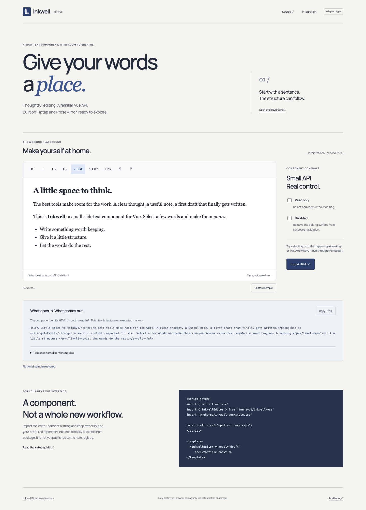

# Inkwell Vue

**A working rich-text component prototype by Neha Desai.** Built with Vue 3, Tiptap and ProseMirror; prepared with AI assistance. Early work, not a production editor or an accessibility certification.

[Try the live playground](https://neha-pd.github.io/inkwell-vue/) · [Source](https://github.com/neha-pd/inkwell-vue)



## What works

- Bold, italic, headings 2/3, bullet and numbered lists, links, undo and redo.
- Controlled HTML `v-model`, external content replacement, and structured `change` events.
- Read-only and disabled modes, a labeled multiline editing surface, visible focus and roving toolbar keyboard navigation.
- A link form with validation and Escape-to-editor focus return.
- Restricted HTML sanitization before imported content/paste enters the editor, and on emitted HTML.
- A live demo with HTML inspection, clipboard copy and local HTML export.

The editing engine is Tiptap/ProseMirror. This does not use `document.execCommand`. The demo has no backend, AI calls, accounts, analytics or persistence; refreshing loses changes.

## Use the package

The package name is **`@neha-pd/inkwell-vue`**, but **it is not published to npm**. Build a local tarball and install that in your Vue app:

```sh
git clone https://github.com/neha-pd/inkwell-vue.git
cd inkwell-vue
npm ci
npm pack
# In your existing Vue 3 application:
npm install /absolute/path/to/inkwell-vue/neha-pd-inkwell-vue-0.1.0.tgz
```

Requires Vue 3.5+ as a peer dependency. The package exports an ESM component, declarations and CSS; Tiptap and DOMPurify are runtime dependencies, not bundled into the library build.

```vue
<script setup>
import { ref } from 'vue'
import { InkwellEditor } from '@neha-pd/inkwell-vue'
import '@neha-pd/inkwell-vue/style.css'

const draft = ref('<p>Start here.</p>')
</script>

<template>
  <InkwellEditor v-model="draft" label="Article body" />
</template>
```

## API

| Prop | Type / default | Behavior |
| --- | --- | --- |
| `modelValue` | `string`, `''` | Supported HTML. External changes replace the document without emitting another update. |
| `label` | `string`, `'Rich text editor'` | Accessible editor name; toolbar name derives from it. Give each editor a distinct label. |
| `readOnly` | `boolean`, `false` | Prevents editing and disables toolbar; document remains focusable for selecting/copying. |
| `disabled` | `boolean`, `false` | Prevents editing, disables toolbar and removes the editor's tab stop. Takes precedence over read-only. |

Events: `update:modelValue(html)` and `change({ html, text })` on editor changes. HTML is sanitized before emitting. Prop synchronization does not emit `change`; initial input is not rewritten in the parent's string until an editing update occurs. Use the exported browser-only `sanitizeHTML` when normalizing a parent value yourself.

Template refs expose `focus()` and `getHTML()`. `focus()` is a no-op when disabled; `getHTML()` returns sanitized editor HTML. Basic TypeScript declarations are included.

Toolbar: Tab enters once; Left/Right arrows cycle buttons, Home/End go to the first/last button. Enter/Space activate a command. Standard Tiptap shortcuts, including Cmd/Ctrl+B and Cmd/Ctrl+I, remain available. Link input accepts complete HTTP, HTTPS or mailto URLs; relative links are intentionally unsupported.

## Content and security boundaries

Allowed markup: paragraphs, hard breaks, bold/emphasis, H2/H3, ordered/unordered lists, list items and links. Images, scripts, embedded content, style/event attributes and unsupported markup are stripped. DOMPurify plus an explicit URL-protocol allowlist protect this editing boundary. This is **not** a security audit or a substitute for server-side validation and sanitization before storing or rendering user content elsewhere. No arbitrary HTML preview is inserted into the demo.

A parent update replaces the current document and may move selection; this is a simple single-user controlled component, not a collaborative state protocol. History comes from ProseMirror and may include external replacements. No tables, images, Markdown parser, file uploads, collaboration, AI, autosave or production support guarantees.

## Browser and SSR limits

The editor is instantiated after mount and needs browser DOM APIs. Server-side rendering displays a placeholder, not document content. For Nuxt/SSR integrations use a client-only boundary; SSR/hydration integration is not yet validated. `sanitizeHTML` returns an empty string outside a browser and is **not** a server sanitizer.

Chromium on macOS was exercised with native Playwright. Safari/Firefox, mobile keyboards, IME composition and screen-reader audits remain to be done. Keyboard checks are not a WCAG conformance claim. The demo's word count is whitespace-based, not a language-aware tokenizer.

## Develop and validate

```sh
npm ci
npm run dev          # http://127.0.0.1:8842
npm run build        # reusable library in dist/
npm run build:demo   # static demo in docs/
npm pack             # prepack rebuilds library
```

`tests/browser.py` uses Python Playwright against port 8842 (or `INKWELL_URL`). Install Playwright/Chromium in your Python environment, start the dev server, then run `python tests/browser.py`.

The browser checks exercise selection and formatting, undo/redo, headings/lists, v-model replacement, read-only/disabled changes, link URL validation, Escape/focus, toolbar keys, malicious HTML and clipboard paste, copy/export round-trips and mobile overflow. Results and actual screenshots are in `artifacts/`.

## License and credits

MIT for this component. Tiptap, ProseMirror, Vue and DOMPurify retain their respective licenses in [THIRD_PARTY_NOTICES.md](THIRD_PARTY_NOTICES.md). The demo's self-hosted Manrope font uses SIL Open Font License in `demo/OFL.txt`.
